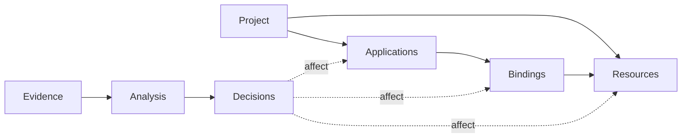
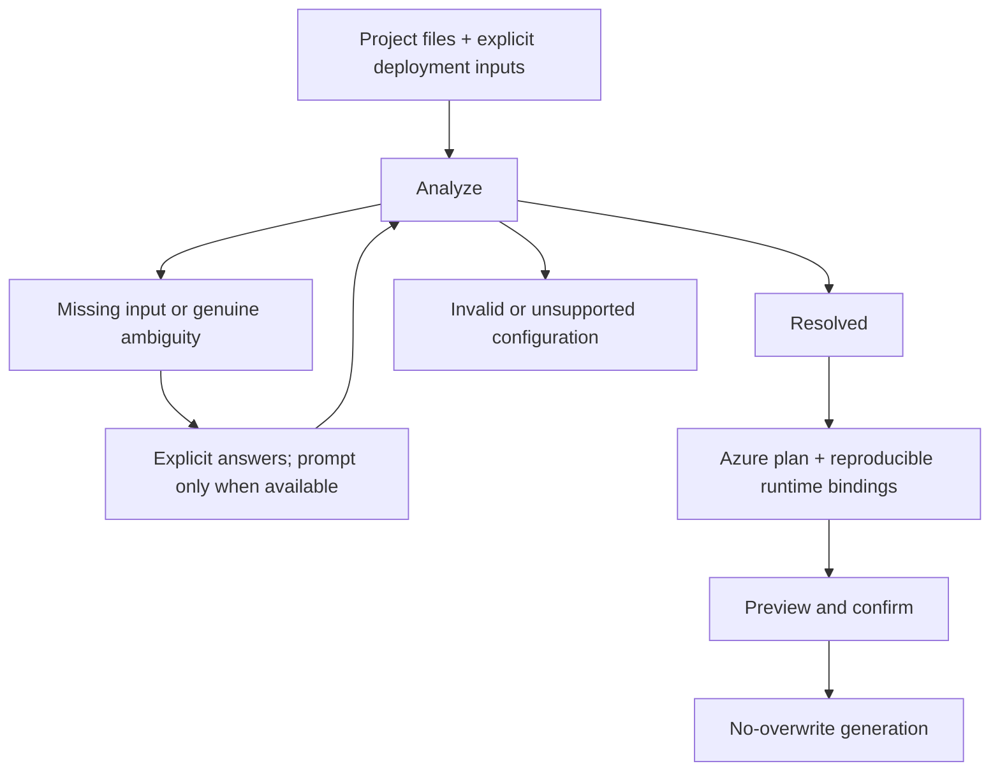

# Spring Boot extension design

Design contract for incremental implementation; support boundaries are in the
[README](README.md).

## Model

- **Application:** deployable identity, build facts, and selected Spring profiles.
- **Resource:** stable logical identity and requirements, such as a PostgreSQL database.
- **Binding:** an application's named dependency, configuration namespace, target
  resource, authentication, JDBC driver/options, and access requirements.
- **Evidence:** source/property, activation context, and placeholder dependencies;
  no credential values.
- **Decision:** stable ID, missing selector/input, evidence, affected identities,
  and answer constraints. Discover dependent decisions by re-analysis.

One application can bind multiple resources; multiple applications can explicitly
share one resource. Never infer sharing from matching names or engines.
Embedded storage is application-local, not a shared cloud resource.
Database placement on shared/separate Azure servers belongs to deployment planning,
not logical resource detection. Model capacity does not imply detector support.

## Resolution

- Application defaults and Spring precedence resolve configuration without extra
  questions. Dependencies establish capabilities, not active resources.
- Inactive alternatives are not requirements. Multiple drivers/profiles alone are
  not ambiguity; do not enumerate every profile combination.
- Missing input identifies a specific unresolved value. Ambiguity requires evidence
  of competing interpretations without a deciding input. Invalid/unsupported
  configuration blocks generation rather than becoming an arbitrary choice.
- Use deliberate deployment inputs, not ambient shell overrides. Distinguish
  unspecified profiles from explicit selection; never silently capture local secrets.
  Expose profile selection, not a generic property-override flag; other answers
  come from targeted prompts or application configuration.
- Answers re-run analysis: a profile choice may affect several resources together.
  Explicit inputs win. Non-interactive execution reports unresolved decisions;
  `--yes` accepts confirmations, not missing configuration choices.
- Pin analyzed profiles at runtime; disable runtime defaults so unused default
  selectors are not evaluated again.
- Use azd host prompt APIs. Keep prompting outside analysis; retain operational
  failures as errors. Never print credentials in evidence, choices, or diagnostics.

## Generation

Generate only from fully resolved, supported bindings. Every binding has an explicit
disposition: application-local or a supported provisioned resource. Preserve the
resolved runtime choice, including embedded bindings; block unsafe reproduction.

Own the generated `azure.yaml`, Docker assets, deployment-only Spring properties,
and parameterized Bicep template. Reuse template modules/parameters, not a template
per configuration combination or text patches to generated Bicep. Use standard
`azd up` for provisioning/deployment. Database hooks exist only where required.
Do not rewrite application source/configuration or overwrite existing deployment files.

## Tests

Test configuration precedence, resource detection, decision classification,
prompt orchestration, and generation independently. Assert that inactive alternatives
do not change the plan and unresolved decisions cannot reach generation.
Use focused shared-resource/conflict cases instead of a Cartesian-product matrix.
A small runtime acceptance set must verify that deployed bindings match the plan
without relying on the initialization shell's environment.
