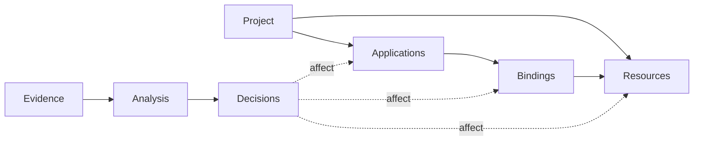
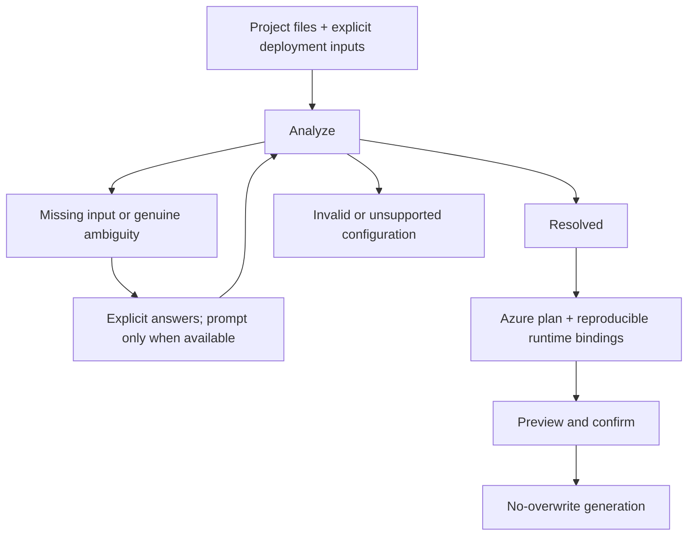
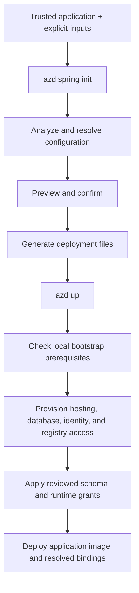

# Spring Boot extension design

Design contract for incremental implementation. Current limitations are summarized
below; detailed support boundaries are in the [README](README.md).

## Model

- **Application:** deployable identity, build facts, and selected Spring profiles.
- **Resource:** stable logical identity and requirements, such as a PostgreSQL database.
- **Binding:** an application's named dependency, configuration namespace, target
  resource, authentication, JDBC driver/options, and access requirements.
- **Evidence:** source/property, activation context, and placeholder dependencies;
  no credential values.
- **Decision:** stable ID, missing selector/input, evidence, affected identities,
  and answer constraints. Discover dependent decisions by re-analysis.

One application can bind multiple resources; multiple applications can explicitly
share one resource. Never infer sharing from matching names or engines.
Embedded storage is application-local, not a shared cloud resource.
Database placement on shared/separate Azure servers belongs to deployment planning,
not logical resource detection. Model capacity does not imply detector support.

## Resolution

- Application defaults and Spring precedence resolve configuration without extra
  questions. Dependencies establish capabilities, not active resources.
- Inactive alternatives are not requirements. Multiple drivers/profiles alone are
  not ambiguity; do not enumerate every profile combination.
- Missing input identifies a specific unresolved value. Ambiguity requires evidence
  of competing interpretations without a deciding input. Invalid/unsupported
  configuration blocks generation rather than becoming an arbitrary choice.
- Use deliberate deployment inputs, not ambient shell overrides. Distinguish
  unspecified profiles from explicit selection; never silently capture local secrets.
  Expose profile selection, not a generic property-override flag; other answers
  come from targeted prompts or application configuration.
- Answers re-run analysis: a profile choice may affect several resources together.
  Explicit inputs win. Non-interactive execution reports unresolved decisions;
  `--yes` accepts confirmations, not missing configuration choices.
- Pin analyzed profiles at runtime; disable runtime defaults so unused default
  selectors are not evaluated again.
- Use azd host prompt APIs. Keep prompting outside analysis; retain operational
  failures as errors.

## Security

- **Credential validation:** inspect every conventional packaged `application*.properties`/YAML document,
  including inactive profiles, and every external application file copied into
  the runtime image. Reject literal `spring.datasource.password` values and
  MySQL/PostgreSQL JDBC user-info or `password` query values. Allow only empty
  values or a single runtime placeholder without a non-empty default.
  Reject MySQL/PostgreSQL JDBC URLs that cannot be safely parsed, including
  unresolved host/port placeholders; parsing failures never imply credential safety.
- **Explicit repair:** interactive runs may repair `spring.datasource.password` in Java
  properties files by removing a placeholder fallback or replacing a literal
  with a runtime-only placeholder. Show only file/property names, require a
  dedicated confirmation even with `--yes`, and never repair in `--no-prompt`.
  Revalidate after the edit without rerunning Maven inspection.
- **Non-disclosure and scope:** never print credentials in evidence, choices, or
  diagnostics. This is targeted validation, not general secret scanning; do not claim to detect
  credentials in arbitrary properties, application code, or other packaged resources.

## Generation

- **Resolved inputs:** generate only from fully resolved, supported bindings.
  Every binding has an explicit disposition: application-local or a supported
  provisioned resource. Preserve the resolved runtime choice, including embedded
  bindings; block unsafe reproduction.
- **Generated assets:** own the generated `azure.yaml`, Docker assets, deployment-only
  Spring properties, and parameterized Bicep template. Reuse template modules/parameters,
  not a template per configuration combination or text patches to generated Bicep.
  Use standard `azd up` for provisioning/deployment. Database hooks exist only where required.
- **Application-owned assets:** preserve a root Dockerfile and supply deployment-owned
  Spring bindings through Container Apps environment variables rather than patching it.
  The application remains responsible for its image contents and external configuration files.
  Reject a root `.dockerignore` without a root Dockerfile before Maven inspection
  and again before writing; generated ignore rules must not bypass application exclusions.
- **Preservation:** do not rewrite application source/configuration except for an
  explicitly confirmed credential repair, and do not overwrite existing deployment files.

## Current Limitations

The implementation supports one single-module Maven Spring Boot HTTP application
with executable JAR packaging and Java 17+, using supported in-memory storage or
at most one external MySQL/PostgreSQL datasource. External databases support password
authentication; PostgreSQL also supports managed identity. Multiple applications,
multiple datasource bindings, shared-resource deployment, MySQL managed identity,
Gradle, and non-web/HTTPS-only hosting remain unsupported. These limits do not
restrict the intended model above.

## Tests

- Test configuration precedence, resource detection, decision classification,
  prompt orchestration, and generation independently. Assert that inactive alternatives
  do not change the plan and unresolved decisions cannot reach generation.
- Use focused shared-resource/conflict cases instead of a Cartesian-product matrix.
- A small runtime acceptance set must verify that deployed bindings match the plan
  without relying on the initialization shell's environment.

## Appendix: Example deployment lifecycle

For a supported PostgreSQL managed-identity application, the generated project
separates initialization from provisioning and deployment:

`init` does not create an azd environment or Azure resources. The bootstrap runs
as the database administrator; the deployed application uses its non-admin managed
identity. This example shows lifecycle dependencies, not every parallel operation
within `azd up`; other database modes omit or replace the bootstrap steps.
