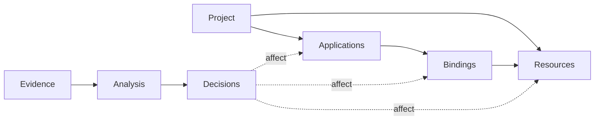
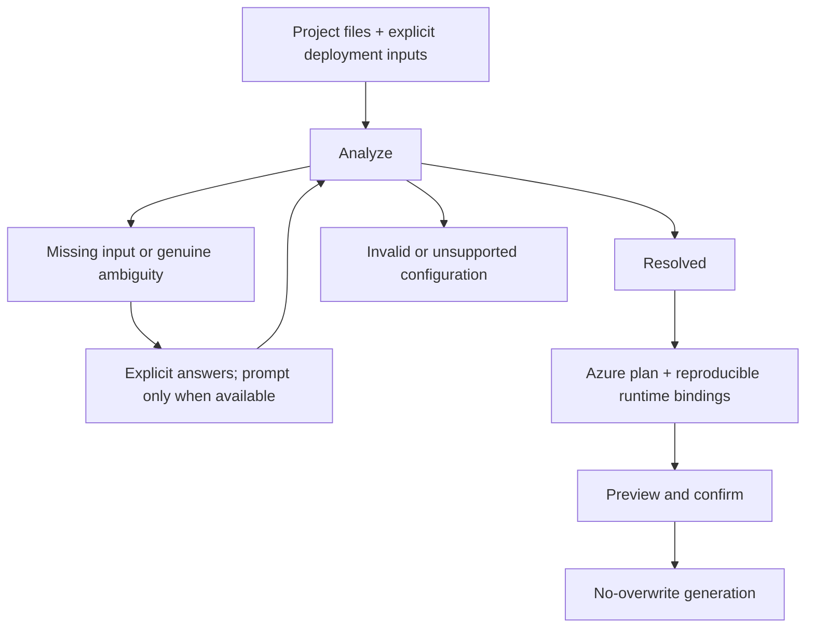
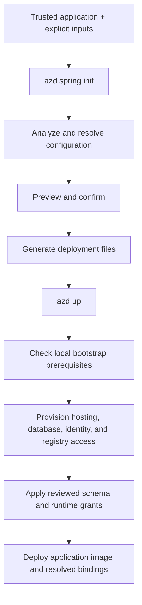
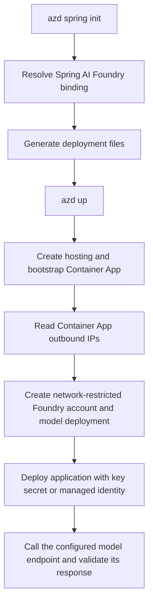

# Spring Boot extension design

Design contract for incremental implementation. Current limitations are summarized
below; detailed support boundaries are in the [README](README.md).

## Model

- **Application:** deployable identity, build facts, and selected Spring profiles.
- **Resource:** stable logical identity and requirements, such as a PostgreSQL database.
- **Binding:** an application's named dependency, configuration namespace, target
  resource, authentication, JDBC driver/options, and access requirements.
- **Evidence:** source/property, activation context, and placeholder dependencies;
  no credential values.
- **Decision:** stable ID, missing selector/input, evidence, affected identities,
  and answer constraints. Discover dependent decisions by re-analysis.

One application can bind multiple resources; multiple applications can explicitly
share one resource. Never infer sharing from matching names or engines.
Embedded storage is application-local, not a shared cloud resource.
Database placement on shared/separate Azure servers belongs to deployment planning,
not logical resource detection. Model capacity does not imply detector support.

## Resolution

- Application defaults and Spring precedence resolve configuration without extra
  questions. Dependencies establish capabilities, not active resources.
- Inactive alternatives are not requirements. Multiple drivers/profiles alone are
  not ambiguity; do not enumerate every profile combination.
- Missing input identifies a specific unresolved value. Ambiguity requires evidence
  of competing interpretations without a deciding input. Invalid/unsupported
  configuration blocks generation rather than becoming an arbitrary choice.
- Use deliberate deployment inputs, not ambient shell overrides. Distinguish
  unspecified profiles from explicit selection; never silently capture local secrets.
  Expose profile selection, not a generic property-override flag; other answers
  come from targeted prompts or application configuration.
- Explicit application inputs classify named runtime environment variables as
  values or secrets. They do not carry values during initialization or imply
  Azure resources. Reject names owned by generated deployment bindings.
- Answers re-run analysis: a profile choice may affect several resources together.
  Explicit inputs win. Non-interactive execution reports unresolved decisions;
  `--yes` accepts confirmations, not missing configuration choices.
- Pin analyzed profiles at runtime; disable runtime defaults so unused default
  selectors are not evaluated again.
- Use azd host prompt APIs. Keep prompting outside analysis; retain operational
  failures as errors.

## Security

- **Credential validation:** inspect every conventional packaged `application*.properties`/YAML document,
  including inactive profiles, and every external application file copied into
  the runtime image. Reject literal `spring.datasource.password` values and
  MySQL/PostgreSQL JDBC user-info or `password` query values. Allow only empty
  values or a single runtime placeholder without a non-empty default.
  Reject MySQL/PostgreSQL JDBC URLs that cannot be safely parsed, including
  unresolved host/port placeholders; parsing failures never imply credential safety.
- **Explicit repair:** interactive runs may repair `spring.datasource.password` in Java
  properties files by removing a placeholder fallback or replacing a literal
  with a runtime-only placeholder. Show only file/property names, require a
  dedicated confirmation even with `--yes`, and never repair in `--no-prompt`.
  Revalidate after the edit without rerunning Maven inspection.
- **Non-disclosure and scope:** never print credentials in evidence, choices, or
  diagnostics. This is targeted validation, not general secret scanning; do not claim to detect
  credentials in arbitrary properties, application code, or other packaged resources.
- **Database network access:** generated MySQL/PostgreSQL servers use public
  endpoints with firewall rules limited to the reported Container Apps outbound
  IP addresses. PostgreSQL managed-identity bootstrap temporarily permits all
  IPv4 sources because the local database egress address cannot be determined
  reliably from HTTPS egress. The bootstrap hook removes only that temporary
  rule on success or failure before recording bootstrap success; it must never
  remain as deployed application access.

## Generation

- **Resolved inputs:** generate only from fully resolved, supported bindings.
  Every binding has an explicit disposition: application-local or a supported
  provisioned resource. Preserve the resolved runtime choice, including embedded
  bindings; block unsafe reproduction.
- **Generated assets:** own the generated `azure.yaml`, Docker assets, deployment-only
  Spring properties, and parameterized Bicep template. Reuse template modules/parameters,
  not a template per configuration combination or text patches to generated Bicep.
  Use standard `azd up` for provisioning/deployment. Database hooks exist only where required.
- **Application-owned assets:** preserve a root Dockerfile and supply deployment-owned
  Spring bindings through Container Apps environment variables rather than patching it.
  The application remains responsible for its image contents and external configuration files.
  Reject a root `.dockerignore` without a root Dockerfile before Maven inspection
  and again before writing; generated ignore rules must not bypass application exclusions.
- **Application inputs:** bind explicit values directly and secrets through secure
  parameters plus Container Apps `secretRef`. Require selected-environment values
  before provisioning and never print them.
- **Preservation:** do not rewrite application source/configuration except for an
  explicitly confirmed credential repair, and do not overwrite existing deployment files.

## Current Limitations

The implementation supports one single-module Maven Spring Boot HTTP application
with executable JAR packaging and Java 17+, using supported in-memory storage or
at most one external MySQL/PostgreSQL datasource, plus one Spring AI Azure OpenAI
binding containing chat, embeddings, or both. External databases support password
authentication; PostgreSQL also supports managed identity. Foundry supports API-key
or managed-identity authentication and one pinned deployment per detected modality.
Chat defaults to `gpt-5.6-sol` version `2026-07-09`; embeddings default to
`text-embedding-3-small` version `1`. Multiple applications, multiple Foundry
accounts, shared-resource deployment, MySQL managed identity, custom model selection,
Gradle, and non-web/HTTPS-only hosting remain unsupported. These limits do not
restrict the intended model above.

Application inputs intentionally use static, data-driven `object` and
`secureObject` Bicep parameters. Release depends on core azd support for
JSON-safe nested environment substitution ([#10688](https://github.com/Azure/azure-dev/issues/10688)),
nested Key Vault reference resolution ([#10691](https://github.com/Azure/azure-dev/issues/10691)),
and single environment mappings in `azd pipeline config`
([#10692](https://github.com/Azure/azure-dev/issues/10692)). Until those fixes
ship, tests use JSON-safe plain values and do not establish that
`azd env set-secret` or pipeline configuration works for application inputs.
Before release, require an azd version containing all three fixes or replace the
object representation with generated scalar parameters.

## Tests

- Test configuration precedence, resource detection, decision classification,
  prompt orchestration, and generation independently. Assert that inactive alternatives
  do not change the plan and unresolved decisions cannot reach generation.
- Use focused shared-resource/conflict cases instead of a Cartesian-product matrix.
- A small runtime acceptance set must verify that deployed bindings match the plan
  without relying on the initialization shell's environment.

## Appendix: Example deployment lifecycle

For a supported PostgreSQL managed-identity application, the generated project
separates initialization from provisioning and deployment:

`init` does not create an azd environment or Azure resources. The bootstrap runs
as the database administrator; the deployed application uses its non-admin managed
identity. This example shows lifecycle dependencies, not every parallel operation
within `azd up`; other database modes omit or replace the bootstrap steps.

## Appendix: Application input ownership and conflicts

<!-- cspell:ignore ADDITIONALLOCATION APIKEY DATASOURCECLASSNAME DDLAUTO DEPLOYMENTNAME DRIVERCLASSNAME JDBCURL OPENAIAPIKEY WEBAPPLICATIONTYPE -->

Application inputs cannot use names that override deployment-owned runtime
configuration. The current reserved contract is:

| Category | Reserved environment variables |
| --- | --- |
| Global override channels | `_JAVA_OPTIONS`, `JAVA_TOOL_OPTIONS`, `JDK_JAVA_OPTIONS`, `SPRING_APPLICATION_JSON` |
| Hosting and configuration | `SERVER_ADDRESS`, `SERVER_PORT`, `SERVER_SSL_ENABLED`, `SPRING_MAIN_WEBAPPLICATIONTYPE`, `SPRING_MAIN_WEB_APPLICATION_TYPE`, `SPRING_CONFIG_IMPORT`, `SPRING_CONFIG_LOCATION`, `SPRING_CONFIG_NAME`, `SPRING_CONFIG_ADDITIONALLOCATION`, `SPRING_CONFIG_ADDITIONAL_LOCATION`, `SPRING_PROFILES_ACTIVE`, `SPRING_PROFILES_DEFAULT`, `SPRING_PROFILES_INCLUDE`, and `SPRING_PROFILES_GROUP_<PROFILE>` for every selected profile |
| Indexed hosting and configuration | `<NAME>_<INDEX>[_]` for `SPRING_CONFIG_IMPORT`, `SPRING_CONFIG_LOCATION`, both additional-location spellings, `SPRING_PROFILES_ACTIVE`, `SPRING_PROFILES_DEFAULT`, `SPRING_PROFILES_INCLUDE`, and `SPRING_PROFILES_GROUP_<PROFILE>` |
| Datasource | `SPRING_AUTOCONFIGURE_EXCLUDE`, `SPRING_CLOUD_AZURE_JDBC_PASSWORDLESSENABLED`, `SPRING_CLOUD_AZURE_JDBC_PASSWORDLESS_ENABLED`, `SPRING_DATASOURCE_AZURE_PASSWORDLESSENABLED`, `SPRING_DATASOURCE_AZURE_PASSWORDLESS_ENABLED`, `SPRING_DATASOURCE_EMBEDDEDDATABASECONNECTION`, `SPRING_DATASOURCE_EMBEDDED_DATABASE_CONNECTION`, `SPRING_DATASOURCE_JNDINAME`, `SPRING_DATASOURCE_JNDI_NAME`, `SPRING_DATASOURCE_URL`, `SPRING_DATASOURCE_USERNAME`, `SPRING_DATASOURCE_PASSWORD`, `SPRING_DATASOURCE_DRIVERCLASSNAME`, `SPRING_DATASOURCE_DRIVER_CLASS_NAME`, `SPRING_JPA_HIBERNATE_DDLAUTO`, `SPRING_JPA_HIBERNATE_DDL_AUTO`, `SPRING_SQL_INIT_MODE`; indexed `SPRING_AUTOCONFIGURE_EXCLUDE_<INDEX>` is also reserved |
| Hikari overrides | `SPRING_DATASOURCE_HIKARI_USERNAME`, `SPRING_DATASOURCE_HIKARI_PASSWORD`, `SPRING_DATASOURCE_HIKARI_JDBCURL`, `SPRING_DATASOURCE_HIKARI_JDBC_URL`, `SPRING_DATASOURCE_HIKARI_DATASOURCECLASSNAME`, `SPRING_DATASOURCE_HIKARI_DATA_SOURCE_CLASS_NAME`, `SPRING_DATASOURCE_HIKARI_DRIVERCLASSNAME`, `SPRING_DATASOURCE_HIKARI_DRIVER_CLASS_NAME` |
| Tomcat overrides | `SPRING_DATASOURCE_TOMCAT_URL`, `SPRING_DATASOURCE_TOMCAT_USERNAME`, `SPRING_DATASOURCE_TOMCAT_PASSWORD`, `SPRING_DATASOURCE_TOMCAT_DRIVERCLASSNAME`, `SPRING_DATASOURCE_TOMCAT_DRIVER_CLASS_NAME` |
| DBCP2 overrides | `SPRING_DATASOURCE_DBCP2_URL`, `SPRING_DATASOURCE_DBCP2_USERNAME`, `SPRING_DATASOURCE_DBCP2_PASSWORD`, `SPRING_DATASOURCE_DBCP2_DRIVERCLASSNAME`, `SPRING_DATASOURCE_DBCP2_DRIVER_CLASS_NAME` |
| Foundry and Spring AI | `AZURE_OPENAI_API_KEY`, `AZURE_OPENAI_ENDPOINT`, `AZURE_OPENAI_CHAT_DEPLOYMENT_NAME`, `AZURE_OPENAI_EMBEDDING_DEPLOYMENT_NAME`, `SPRING_AI_MODEL_CHAT`, `SPRING_AI_MODEL_EMBEDDING`, `SPRING_AI_AZURE_OPENAI_APIKEY`, `SPRING_AI_AZURE_OPENAI_API_KEY`, `SPRING_AI_AZURE_OPENAI_OPENAIAPIKEY`, `SPRING_AI_AZURE_OPENAI_OPENAI_API_KEY`, `SPRING_AI_AZURE_OPENAI_ENDPOINT`, `SPRING_AI_AZURE_OPENAI_CHAT_OPTIONS_DEPLOYMENTNAME`, `SPRING_AI_AZURE_OPENAI_CHAT_OPTIONS_DEPLOYMENT_NAME`, `SPRING_AI_AZURE_OPENAI_EMBEDDING_OPTIONS_DEPLOYMENTNAME`, `SPRING_AI_AZURE_OPENAI_EMBEDDING_OPTIONS_DEPLOYMENT_NAME` |
| Generated database bindings | `MYSQL_DATABASE`, `MYSQL_HOST`, `MYSQL_PASSWORD`, `MYSQL_PORT`, `MYSQL_USERNAME`, `POSTGRES_DATABASE`, `POSTGRES_HOST`, `POSTGRES_PASSWORD`, `POSTGRES_PORT`, `POSTGRES_USERNAME` |

When the extension generates or relies on a runtime property, every
higher-precedence environment spelling capable of overriding that property must
be added to this contract and its conflict tests. Inputs referenced directly or
indirectly by deployment-owned properties are also rejected, including references
from every profile-include source, selected profile groups, nested or interpolated
placeholders, and dotted names resolved through relaxed environment aliases.
Application-specific names outside this ownership boundary remain valid.

## Appendix: Foundry model bindings

Foundry support targets Spring AI Azure OpenAI chat and embedding bindings.
The acceptance application and reviewed generated output live in the independent
`azure-dev-spring-extension-tests` repository.

- Detect `spring-ai-starter-model-azure-openai` and the standard endpoint,
  API-key, selectors, and modality deployment-name properties. Model Foundry
  separately from datasource bindings so an application may use both.
- Preserve chat as the legacy default when only shared Azure OpenAI properties
  are configured. Require explicit selector or deployment-name evidence for
  embeddings. Reject modality properties that cannot take effect because their
  selector chooses another provider.
- Reject a non-empty or unresolved `spring.ai.azure.openai.openai-api-key`;
  Spring AI gives it precedence and connects to public OpenAI. Pin the
  deployment-owned value empty so Azure API-key injection cannot activate it.
- Select API-key authentication when the active API-key property is non-empty.
  When it is absent or empty, follow Spring AI 1.0.0 semantics and use
  `DefaultAzureCredential` with the Container App managed identity.
- Provision a `Microsoft.CognitiveServices/accounts` resource with kind
  `AIServices`, `allowProjectManagement` enabled, and one account-level
  `accounts/deployments` resource per detected modality. A Foundry project is
  not required for direct Azure OpenAI-compatible inference.
- Parameterize each deployment's model name, version, SKU, and deployment name.
  Chat defaults to `gpt-5.6-sol` version `2026-07-09`; embeddings default to
  `text-embedding-3-small` version `1`. Azure upgrades each deployment when its
  current version expires.
- Enable local authentication for the key-based Spring AI application. Obtain the
  key only within Bicep and inject it directly as a Container Apps secret; do not
  persist it in azd environment values, generated files, outputs, logs, or errors.
- For managed identity, disable local authentication, grant the bootstrap Container
  App identity `Cognitive Services OpenAI User` on the account, and generate no key
  lookup, secret, or API-key environment variable.
- Apply datasource-password credential rules to the API-key property: inspect
  active and inactive packaged configuration plus copied external configuration,
  allow only empty or runtime-placeholder values, and reject literals without
  disclosure. Any repair remains explicit, interactive, and revalidated.
- Keep public network access enabled but set the account network ACL default to
  deny. Allow only the Container App outbound IP addresses, matching the database
  firewall model. Reprovisioning refreshes this allowlist; stable NAT or private
  networking remains deferred.
- Bind the OpenAI-compatible `*.openai.azure.com` endpoint and model deployment
  through deployment-owned Spring configuration. Bind the account key only in
  API-key mode; managed identity relies on `DefaultAzureCredential`.

